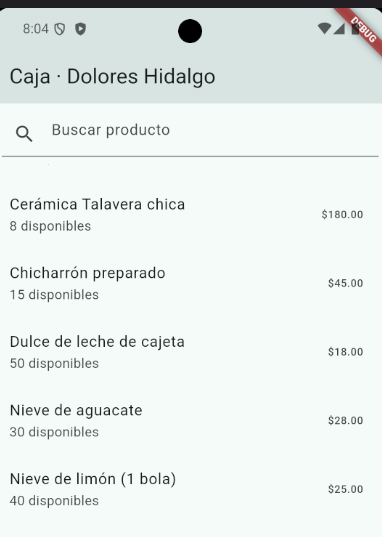
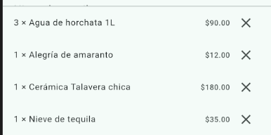
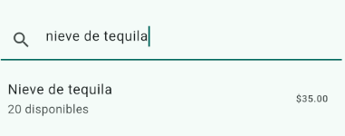
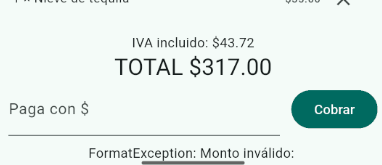

# Pruebas del Sistema - Punto de Venta Dolores

## Descripción
Este repositorio contiene el código fuente y las evidencias de las pruebas realizadas para el sistema de punto de venta.

## Pruebas Realizadas

### 1. Pantalla Principal del Sistema
* **Descripción:** Verificación de la carga e interfaz principal del sistema de ventas[cite: 2].
* **Resultado:** Exitoso[cite: 2].
* **Evidencia:**  
  

### 2. Registro y Consulta de Productos
* **Descripción:** Pruebas en el módulo de gestión de productos para dar de alta y validar la información registrada[cite: 2].
* **Resultado:** Exitoso[cite: 2].
* **Evidencia:**  
  

### 3. Buscador de Productos
* **Descripción:** Validación de la funcionalidad de búsqueda dinámica de productos en el catálogo[cite: 2].
* **Resultado:** Exitoso[cite: 2].
* **Evidencia:**  
  

### 4. Monto a Pagar
* **Descripción:** Verificación del cálculo total y el desglose del monto a pagar en el ticket de venta.
* **Resultado:** Exitoso.
* **Evidencia:**  
  

## Tecnologías Utilizadas
* **Framework:** Flutter (Dart)
* **Base de datos:** SQLite (`sqflite`)